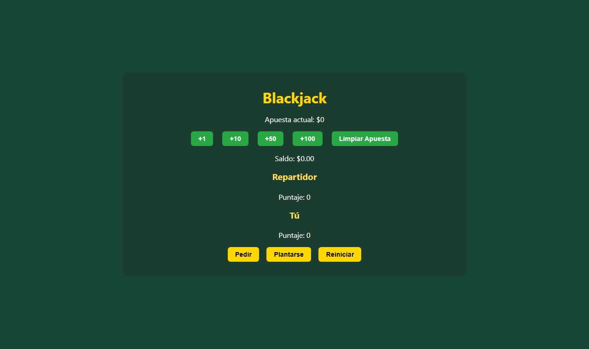
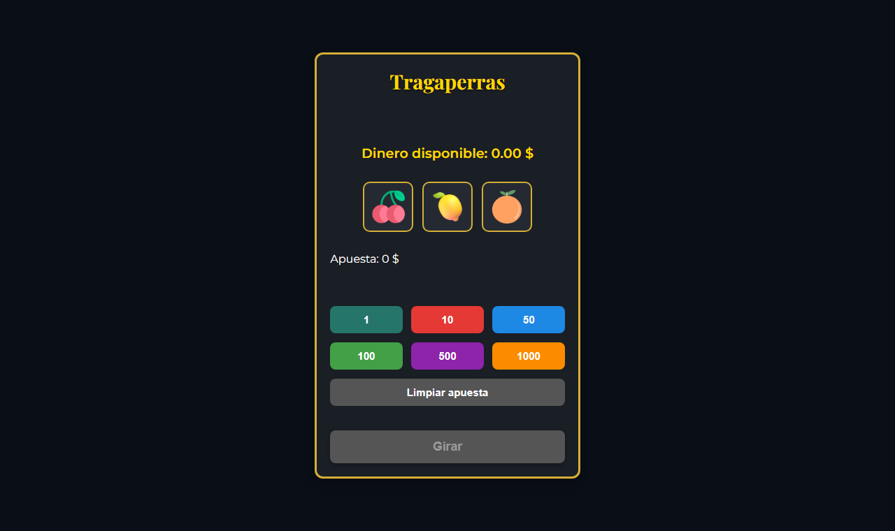
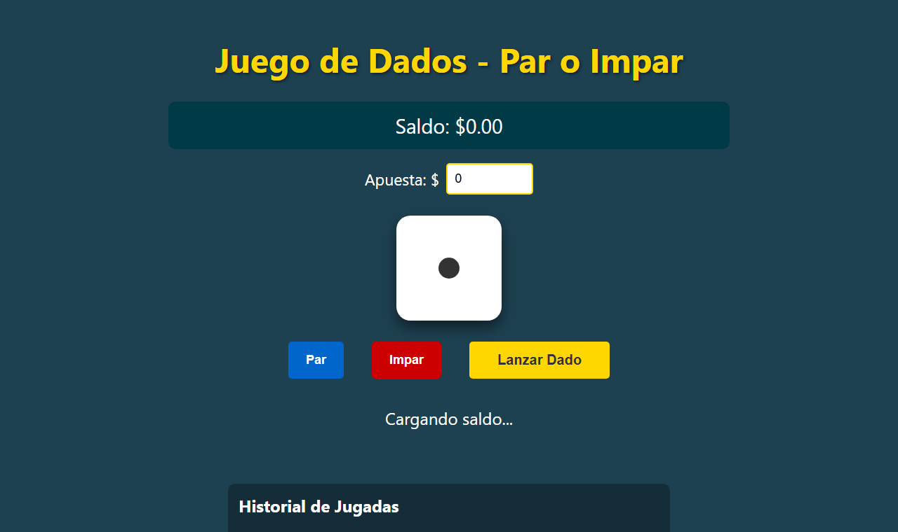
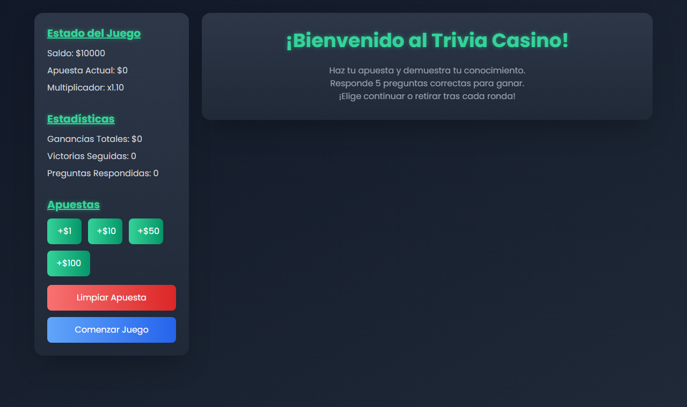

# Casino 4 Hermanos

Aplicación de escritorio de un casino virtual hecha en Java con JavaFX. El usuario inicia sesión, deposita saldo y juega en cinco mesas distintas; el saldo se guarda en MySQL y se actualiza en cada jugada.



## Juegos

- **Blackjack**
- **Tragaperras**
- **Póker Texas Hold'em**
- **Dados (par o impar)**
- **Trivia Casino:** apuestas respondiendo preguntas, con multiplicador por racha.

## Cómo está hecho

La ventana principal, el inicio de sesión y el manejo del saldo están en Java (JavaFX). Cada juego está hecho con HTML, CSS y JavaScript, y se carga dentro de la aplicación con un `WebView`.

Para que los juegos y Java compartan el mismo saldo, cada ventana expone un objeto de Java al JavaScript del juego (`JSObject.setMember`). Cuando el jugador gana o pierde, el juego llama a ese objeto y Java actualiza el saldo en la base de datos. Así el saldo es uno solo aunque cambies de mesa.

Otras cosas que tiene:

- Inicio de sesión contra MySQL; las contraseñas se guardan con hash SHA-256, no en texto plano.
- Todas las consultas usan `PreparedStatement`.
- Depósitos y retiros. Los retiros cobran una comisión del 15 % y generan un ticket en PDF (con Apache PDFBox) que se guarda en la carpeta de Descargas con un código único.
- La conexión a la base de datos está en una sola clase (`ConexionBD`) y se puede configurar con variables de entorno.

## Tecnologías

Java 24, JavaFX 24 (WebView), MySQL 8 con MySQL Connector/J, Apache PDFBox, HTML, CSS y JavaScript. Proyecto de NetBeans (Ant).

## Cómo correrlo

1. Crea la base de datos con `database/4hermanos.sql`. Incluye un usuario de prueba: `demo@casino.com` / `demo1234`.
2. Descarga el [JavaFX SDK 24](https://gluonhq.com/products/javafx/) y descomprímelo en `Librerias/javafx-sdk-24.0.1`. Los demás `.jar` ya vienen en `Librerias/`.
3. Abre el proyecto en NetBeans con JDK 24 y ejecútalo.

Por defecto se conecta a `localhost:3306` con el usuario `root` sin contraseña. Si tu MySQL es distinto, define estas variables de entorno:

```
CASINO_DB_URL=jdbc:mysql://localhost:3306/4hermanos?useSSL=false&serverTimezone=UTC
CASINO_DB_USER=root
CASINO_DB_PASSWORD=tu_contraseña
```

## Estructura

```
src/GUI/        clases de Java: sesión, ventana principal, saldo y una clase por juego
src/BlackJack/  src/TragaPerras/  src/PokerTexas/  src/dados/  src/Preguntas/
                cada juego en HTML, CSS y JavaScript
database/       script de la base de datos
Librerias/      dependencias (.jar)
```

## Capturas

| Tragaperras | Dados | Trivia |
|---|---|---|
|  |  |  |

---

Jonathan Samuel Díaz Torres · [LinkedIn](https://www.linkedin.com/in/diaz-torres-jonathan-samuel-79023a2a2/)
